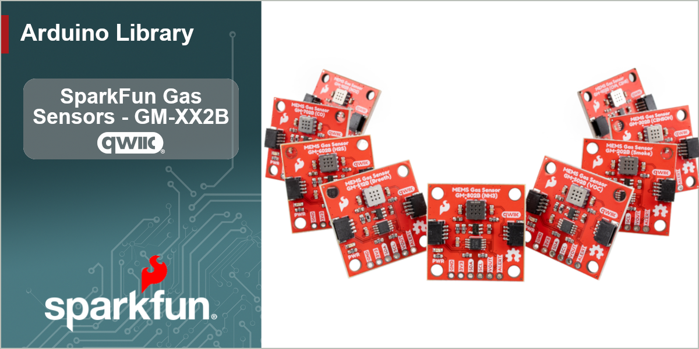

<!--
  SPLASH IMAGE - REQUIRED, and the first element of the README.
  Build it from one of the blank banner templates in the Arduino Library HowTo repo
  (docs/images/gh-banner-simple-qw-ard.png), add the repo name on the left and a product
  photo + board tile in the white area, save it here as docs/images/gh-banner-gm-x02b.png,
  and upload the same image as the repo's Social preview under Settings > General.
-->


# SparkFun Qwiic MEMS Gas Sensors - GM-X02B

Arduino Library for the SparkFun Qwiic MEMS gas sensor breakouts, covering all nine Winsen GM-x02B sensing elements.


[](https://github.com/sparkfun/SparkFun_GM-X02B_Arduino_Library/actions/workflows/test-compile-sketch.yml)


## Library Description

The SparkFun Qwiic MEMS gas sensor boards put Winsen's GM-x02B metal-oxide semiconductor (MOS) gas sensing elements on Qwiic-enabled breakouts. Each board pairs one sensing element with a Texas Instruments ADC101C021 10-bit I2C ADC, so gas readings arrive over Qwiic with no external ADC required.

All nine variants share one board design and one library. Pick your gas:

| Board | Class | Target gas | Range | Default address |
| -- | -- | -- | -- | -- |
| **GM-102B** | `SfeGM102BArd` | Nitrogen dioxide (NO<sub>2</sub>) | 0.1 - 10 ppm | `0x50` |
| **GM-202B** | `SfeGM202BArd` | Alcohol, smoke | 10 - 1000 ppm | `0x51` |
| **GM-302B** | `SfeGM302BArd` | Ethanol | 1 - 500 ppm | `0x52` |
| **GM-402B** | `SfeGM402BArd` | Methane, propane | 1 - 10000 ppm | `0x54` |
| **GM-502B** | `SfeGM502BArd` | VOCs | 1 - 500 ppm | `0x55` |
| **GM-512B** | `SfeGM512BArd` | Breath odor (H<sub>2</sub>S) | 0.5 - 50 ppm | `0x56` |
| **GM-602B** | `SfeGM602BArd` | Hydrogen sulfide (H<sub>2</sub>S) | 0.5 - 50 ppm | `0x58` |
| **GM-702B** | `SfeGM702BArd` | Carbon monoxide (CO) | 5 - 5000 ppm | `0x59` |
| **GM-802B** | `SfeGM802BArd` | Ammonia (NH<sub>3</sub>) | 1 - 300 ppm | `0x5A` |

Built on the [SparkFun Toolkit](https://github.com/sparkfun/SparkFun_Toolkit).

## Functionality

- Raw 10-bit ADC readings, output voltage, and sensing element resistance (Rs)
- Clean-air calibration (measure and store R0, or restore a saved value)
- **Direction-normalized gas response** that reads the same way on all nine parts
- Optional user-fitted ppm conversion, plus per-part detection ranges
- Hardware gas threshold alerts with programmable limits and hysteresis
- ALERT pin support (open-drain, configurable polarity and hold behavior)
- Automatic conversion mode, where the ADC monitors the sensor on its own
- Hardware peak gas tracking, mapped to the correct extremum register per part, in counts or volts
- Multiple boards on one bus, in any mix of gases

## GM-102B sensor direction

Eight of the nine sensing elements detect **reducing** gases. Their resistance **falls** as gas concentration rises, so ADC counts rise.

The GM-102B detects NO₂, an **oxidizing** gas. Its resistance **rises** with concentration, so its ADC counts *fall*. Its datasheet specifies `R0(air)/Rs(2ppm NO2) ≤ 0.5`, where every other part specifies `≥ 2` or `≥ 3`.

Because Rs sits on the high side of the load-resistor divider, that inversion affects which direction the counts move, which alert limit means "gas detected", and which hardware min/max register holds the peak gas reading.

The library handles this. Use `getGasResponse()` instead of `getRatio()`, `setGasAlertResponse()` instead of the raw limit registers, `getGasAlert()` instead of `getAlertStatus()`, and `getPeakGasCounts()` / `getPeakGasVoltage_V()` instead of `getHighestConversion()`. Those four are direction-aware, so one sketch works on any board in the family. The raw register accessors are also available. They're direction-neutral, and `rsRisesWithGas()` tells you which way your part goes if you want to do the mapping yourself.

## Hardware Connections

The boards connect over I2C using the Qwiic connector, so no soldering is required. Each variant ships at a unique default address (set by the tri-level ADR1 / ADR0 jumpers), so multiple boards coexist on one bus. The PTH header also breaks out the raw analog VOUT and the ADC's ALERT output.

> [!WARNING]
> **No pull-up is fitted on ALERT.** The ADC101C021's ALERT is an open-drain output in *both* polarity modes, so the pin floats unless something pulls it high. For a single board the MCU's internal pull-up is enough (`pinMode(alertPin, INPUT_PULLUP)`) because ALERT leaks at most 1 µA when high-impedance, so even a weak 50 kΩ internal pull-up droops only 50 mV. Fit a discrete **10 kΩ to 3.3 V** when your MCU pin has no internal pull-up, when several boards share one alert line, or when the wire is long: that's 330 µA of sink current (well inside the 3 mA V<sub>OL</sub> spec), 10 mV of droop, and a ~0.2 µs edge. Keep it between 1 kΩ and 100 kΩ. The pin is not required to use the alert function; `getGasAlert()` reads the same condition over I2C. Example03 shows both.

**The GM-102B carries a 68.1 kΩ load resistor** where the rest of the family uses 4.7 kΩ. Its datasheet Rs spread (10 kΩ to 1 MΩ) sits 10 to 30 times higher than most of the family's (1 kΩ to 30 kΩ), and with 4.7 kΩ a unit at the high end of the manufacturing spread produces under five ADC counts of usable swing. The library reads the correct value from its per-part table, so you don't need to set it.

> [!IMPORTANT]
> These are heated MOS sensors and must be preheated before use: allow a few minutes for the output to stabilize after power-up, and after long unpowered storage Winsen recommends 24 to 168 hours of powered aging depending on the part (see its datasheet). Out of the box these boards are suited to **relative** measurement and threshold alerts; **absolute ppm requires calibration** against known gas concentrations. Never expose the sensing element to organic silicon vapors, and see the datasheet cautions for other handling notes.

## Using the Library

### Installation

Install through the Arduino Library Manager by searching for **SparkFun Qwiic Gas Sensor**, or download this repository as a ZIP and add it via *Sketch > Include Library > Add .ZIP Library*. This library depends on the [SparkFun Toolkit](https://github.com/sparkfun/SparkFun_Toolkit), which the Library Manager will offer to install alongside it.

### Getting Started

Declare which board you have by picking its class. There is one per variant, so the part is set by the class type:

```c++
#include <SparkFun_GMX02B.h>

// Uncomment the board you're using
// SfeGM102BArd mySensor;   // GM-102B - nitrogen dioxide (NO2)
// SfeGM202BArd mySensor;   // GM-202B - alcohol, smoke
// SfeGM302BArd mySensor;   // GM-302B - ethanol
// SfeGM402BArd mySensor;   // GM-402B - methane, propane
// SfeGM502BArd mySensor;   // GM-502B - VOCs
// SfeGM512BArd mySensor;   // GM-512B - breath odor
SfeGM602BArd mySensor;      // GM-602B - hydrogen sulfide (H2S)
// SfeGM702BArd mySensor;   // GM-702B - carbon monoxide (CO)
// SfeGM802BArd mySensor;   // GM-802B - ammonia (NH3)
```

The library can't read the sensing element back from the hardware (the ADC101C021 has no ID register), and the wrong part inverts the GM-102B's readings and selects the wrong load resistor, so the part must be declared.

If you need to pick the part at runtime, or hold several boards in one array, use the generic class with a **required** part argument (there is no default):

```c++
SfeGMX02BArd mySensor(GM_602B);
```

In `setup()`, start I2C and call `begin()`:

```c++
Wire.begin();

while (mySensor.begin() == false)   // this part's factory address, 0x58
{
    Serial.println("Gas sensor not connected, check your wiring!");
    delay(1000);
}
```

### Part and address

The part and the I2C address are set separately. The **part** is declared; the **address** defaults from it but can be overridden:

```c++
mySensor.begin();          // factory address for the declared part
mySensor.begin(0x51);      // jumpers moved: same sensor, new address, correct math
```

This keeps a re-addressed board reading correctly. If the part were inferred from the address, moving an ADR jumper could cause a GM-102B to be treated as a GM-602B, inverting its readings.

### Using several of the same sensor

The library doesn't tie a part number to an address, so several boards of the same type work the same way as several boards of different types. Give each one its own object and its own address:

```c++
// Three H2S boards. Two have had their ADR jumpers moved off the factory 0x58.
SfeGM602BArd intake;
SfeGM602BArd exhaust;
SfeGM602BArd ambient;

intake.begin();          // 0x58, the GM-602B factory address
exhaust.begin(0x50);     // re-jumpered
ambient.begin(0x55);     // re-jumpered
```

All three keep the GM-602B's curve direction, its 4.7 k&#8486; load resistor, and its detection range, because those come from the **declared part**, not the address. Each object holds its own bus handle, its own cached reading, and its own R0. The const part table is shared but read-only, so instances don't interfere.

**Any board can take any of the nine addresses.** The two tri-state jumpers give 3 &times; 3 = 9 combinations, and each variant ships on a different one so that a one-of-each bus works without changes. The decode table is in the comment block at the top of `sfDevGMX02B.cpp`.

Things to keep in mind:

- **Nine boards per bus is the ceiling**, whatever the mix of types, because there are only nine addresses. For more, use a second I2C port: `begin()` takes a `TwoWire&`, so `fourth.begin(0x58, Wire1)` puts another nine on `Wire1`.
- **Each unit needs its own clean-air calibration.** R0 belongs to an individual sensing element, not to a part number, and Winsen's part-to-part spread is on the order of 10:1, so two GM-602Bs in the same clean air will have different R0 values. Call `measureCleanAirResistance()` per object.
- **The library can't detect an address collision.** If you forget to re-jumper one board and two sit at 0x58, both ACK and you get contention, not an error. Double-check the ADR jumpers for duplicates before you trust the readings.

### Reading the Sensor

`readMeasurement()` fetches a conversion, and the getters return it in different forms. Following the SparkFun Toolkit convention, getters that can fail return an `sfTkError_t` and hand back the value through an output reference:

```c++
float ohms;

mySensor.readMeasurement();
mySensor.getSensorResistance_Ohm(ohms);

Serial.print("Raw: ");
Serial.print(mySensor.getRaw());           // 0 - 1023
Serial.print("  Voltage: ");
Serial.print(mySensor.getVoltage_V(), 3);  // volts across the load resistor
Serial.print("  Rs: ");
Serial.println(ohms, 0);                   // ohms
```

`getRaw()` and `getVoltage_V()` return directly because they read the cached conversion and cannot fail. `getSensorResistance_Ohm()`, `getRatio()`, `getGasResponse()` and `getConcentration_ppm()` return an `sfTkError_t`, because each can fail: no clean-air reference, an off-scale reading, no fitted curve. Example03 shows the checked form; the other examples skip it for brevity.

To express a raw register value in volts, `countsToVoltage_V()` converts ADC counts to sensor output voltage. It is the inverse of `voltageToCounts()`.

### Clean-Air Response

Calibrate once in clean air with the sensor warmed up, then read the gas response. It is near **1.0 in clean air and rising with gas on every part in the family**:

```c++
float r0;
mySensor.measureCleanAirResistance(r0);   // averages 16 readings and stores R0

float response;
mySensor.readMeasurement();
mySensor.getGasResponse(response);
```

Because the response is normalized in the same direction the datasheets quote sensitivity, it compares directly against `getRatedSensitivity()`:

| Part | Datasheet spec | Equivalent test |
| -- | -- | -- |
| GM-602B | `R0/Rs ≥ 3` in 50 ppm H₂S | `getGasResponse() >= 3.0` |
| GM-102B | `R0/Rs ≤ 0.5` in 2 ppm NO₂ | `getGasResponse() >= 2.0` |

`getRatio()` still returns the raw physical Rs/R0 if you want to plot against a datasheet curve.

### Hardware Alerts

The ADC can monitor the sensor on its own. Set a threshold in response units, enable automatic conversion mode, and poll the flag (or wire the ALERT pin to an interrupt):

```c++
mySensor.setGasAlertResponse(2.0);            // twice the clean-air response
mySensor.setAlertHysteresis_mV(32.0);         // in mV of sensor output, not ADC counts
mySensor.setCycleTime(GM_CYCLE_TIME_2048);    // ADC free-runs

bool gasDetected;
mySensor.getGasAlert(gasDetected);
if (gasDetected)
    Serial.println("Gas threshold exceeded!");
```

`setGasAlertResponse()` writes the high limit on a falling-Rs part and the low limit on the GM-102B; `getGasAlert()` maps the status flags back the same way.

### Peak Tracking

In automatic conversion mode the ADC also records its lowest and highest conversions in hardware, so a gas spike between polls is still captured. `getPeakGasVoltage_V()` reads whichever register holds the peak gas reading for your part:

```c++
mySensor.setCycleTime(GM_CYCLE_TIME_2048);    // min/max registers only update in automatic mode
mySensor.clearPeakGasCounts();

float peak;
mySensor.getPeakGasVoltage_V(peak);           // peak sensor output voltage since the last clear
```

`getPeakGasCounts()` returns the same reading in raw counts.

### Concentration in ppm

This library does not include conversion curves. Winsen publishes no numeric curve data for any GM-x02B part (the datasheet sensitivity plots are raster images with no axis values), and the GM-602B manual describes the response as "non linear, hysteretic and non-repetitive."

If you characterize a sensor against known gas concentrations, fit a power law and pass it to the library:

```c++
mySensor.setResponseCurve(a, b);          // ppm = a * pow(gas response, b)

float ppm;
if (mySensor.getConcentration_ppm(ppm) != ksfTkErrOk)
    Serial.println("No curve fitted for this sensor yet");
else if (!mySensor.isInRange(ppm))
    Serial.println("Outside this part's rated detection range");
```

## Examples

- **Example01_BasicReadings**: raw counts, voltage, and sensor resistance once per second
- **Example02_CleanAirResponse**: clean-air calibration and direction-normalized response
- **Example03_GasAlertThreshold**: hardware gas threshold alert using automatic conversion mode
- **Example04_PeakTracking**: hardware peak gas tracking over a rolling window
- **Example05_MultipleSensors**: three gases on one bus, including the inverted GM-102B (see [Using several of the same sensor](#using-several-of-the-same-sensor) for identical boards at custom addresses)

## Repository Contents

* **/.github/workflows** - GitHub Action workflows for the compile test and documentation build.
* **/docs** - Configuration files for the documentation.
* **/examples** - Example sketches for the library (.ino). Run these from the Arduino IDE.
* **/src** - Source files for the library (.cpp, .h).
* **keywords.txt** - Keywords from this library that will be highlighted in the Arduino IDE.
* **library.properties** - General library properties for the Arduino package manager.

## Documentation

* **[Library Documentation](https://docs.sparkfun.com/SparkFun_GM-X02B_Arduino_Library/)** - Doxygen-generated API reference for this library.
* **[Hookup Guide](https://docs.sparkfun.com/SparkFun_Qwiic_MEMS_Hydrogen_Sulfide_Sensor_GM-602B/)** - Hookup guide, including preheating, calibration, and handling cautions.
* **[Installing an Arduino Library Guide](https://learn.sparkfun.com/tutorials/installing-an-arduino-library)** - Basic information on how to install an Arduino library.
* **[Hardware Repository](https://github.com/sparkfun/SparkFun_Qwiic_Gas_Sensor_GM-602B)** - Design files for the board.

## Products That Use This Library

| Product ID | Description |
| -- | -- |
| TODO | SparkFun Qwiic MEMS Nitrogen Dioxide Sensor - GM-102B |
| TODO | SparkFun Qwiic MEMS Alcohol / Smoke Sensor - GM-202B |
| TODO | SparkFun Qwiic MEMS Ethanol Sensor - GM-302B |
| TODO | SparkFun Qwiic MEMS Combustible Gas Sensor - GM-402B |
| TODO | SparkFun Qwiic MEMS VOC Sensor - GM-502B |
| TODO | SparkFun Qwiic MEMS Breath Odor Sensor - GM-512B |
| TODO | SparkFun Qwiic MEMS Hydrogen Sulfide Sensor - GM-602B |
| TODO | SparkFun Qwiic MEMS Carbon Monoxide Sensor - GM-702B |
| TODO | SparkFun Qwiic MEMS Ammonia Sensor - GM-802B |

## License Information

This product is ***open source***!

This product is licensed using the [MIT Open Source License](https://opensource.org/license/mit)
